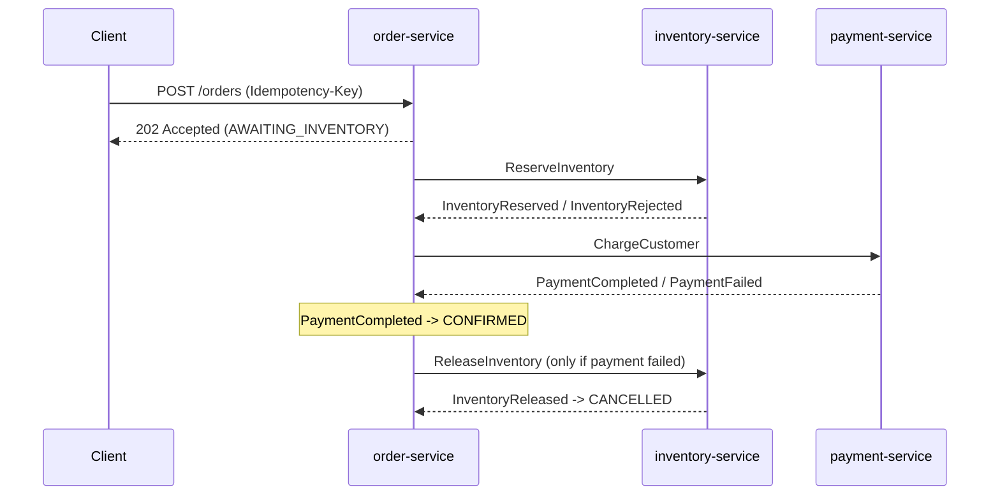

# Resilient Order System

Three Spring Boot services that place an order, reserve stock and charge a wallet **without a distributed transaction**.
They coordinate with a saga over Kafka; every service has its own database and only talks to the others through messages.
### Live Demo : https://resilient-order-shubho.netlify.app/
| Service | Port | Owns | Role |
|---|---|---|---|
| order-service | 8081 | `order_db` | REST API, saga orchestrator, timeouts |
| inventory-service | 8082 | `inventory_db` | stock and reservations |
| payment-service | 8083 | `payment_db` | wallets and an append-only ledger |

## The saga



- **Rejected stock** ends the order as `REJECTED`. **Failed payment** releases the reserved stock (compensation) and ends as `CANCELLED`.
- An order idle in a non-final state for 60 s is cancelled and both compensations are sent (`saga.timeout`).

## Run it

```
docker compose up -d            # Kafka, Postgres (3 databases), Kafka UI on :8085
cd order-service     && ./gradlew bootRun
cd inventory-service && ./gradlew bootRun
cd payment-service   && ./gradlew bootRun
./gradlew test                  # in each service: no Docker needed (H2 in PostgreSQL mode)
```

Demo data: stock `SKU-1` 100, `SKU-2` 5, `SKU-3` 0; wallets `CUST-1` 1000.00, `CUST-2` 10.00.

```
# happy path
curl -X POST localhost:8081/orders -H "Content-Type: application/json" -H "Idempotency-Key: demo-1" \
     -d '{"customerId":"CUST-1","productId":"SKU-1","quantity":2,"amount":25.00}'
curl localhost:8081/orders/<id>            # status CONFIRMED after a moment
curl localhost:8083/wallets/CUST-1         # balance went down by 25.00
curl localhost:8082/stock/SKU-1            # stock went down by 2

# out of stock: use SKU-3 -> REJECTED.   Not enough money: use CUST-2 with amount 50 -> CANCELLED, stock is given back.
# same Idempotency-Key and body again -> 200 with the same order; same key, different body -> 409
```

## Design decisions

- **Orchestration saga** with a state machine in order-service; each state change is a compare-and-set, so duplicate, late or racing messages change nothing.
- **Transactional outbox:** the state change and the next message are written in one transaction; a publisher sends them and waits for the broker acknowledgement before marking them sent. Delivery is at least once.
- **Inbox + natural keys:** consumers record each message id in the same transaction as their effect, and keep one row per order (reservation, payment), so repeats and reordering are harmless. A release or refund that overtakes its reserve or charge leaves a marker that makes the late command fail.
- **Kafka:** key = order id (one order stays in sequence), `acks=all`, idempotent producer, retry with backoff, then a `<topic>.DLT` dead-letter topic.
- **Money safety:** wallet debit is `UPDATE ... WHERE balance >= amount`; stock reserve is `UPDATE ... WHERE available >= quantity`; the ledger is append-only with one debit and one credit per order at most.
- **Observability:** `/actuator/prometheus` exposes `outbox.pending` (lag), `outbox.published`, `saga.outcome{result}`, `saga.duration`.

## Known limits

- Tested per service against H2 in PostgreSQL mode, not against a real Postgres and Kafka together (no end-to-end test yet).
- The outbox is polled (200 ms) and sends one message at a time to keep order; at high volume use CDC (Debezium) or several pollers.
- Each service keeps its own copy of the message contract; a schema registry or contract tests would guard against drift.
- No authentication, no replay tool for the dead-letter topics, a single Kafka broker and replication factor 1.
